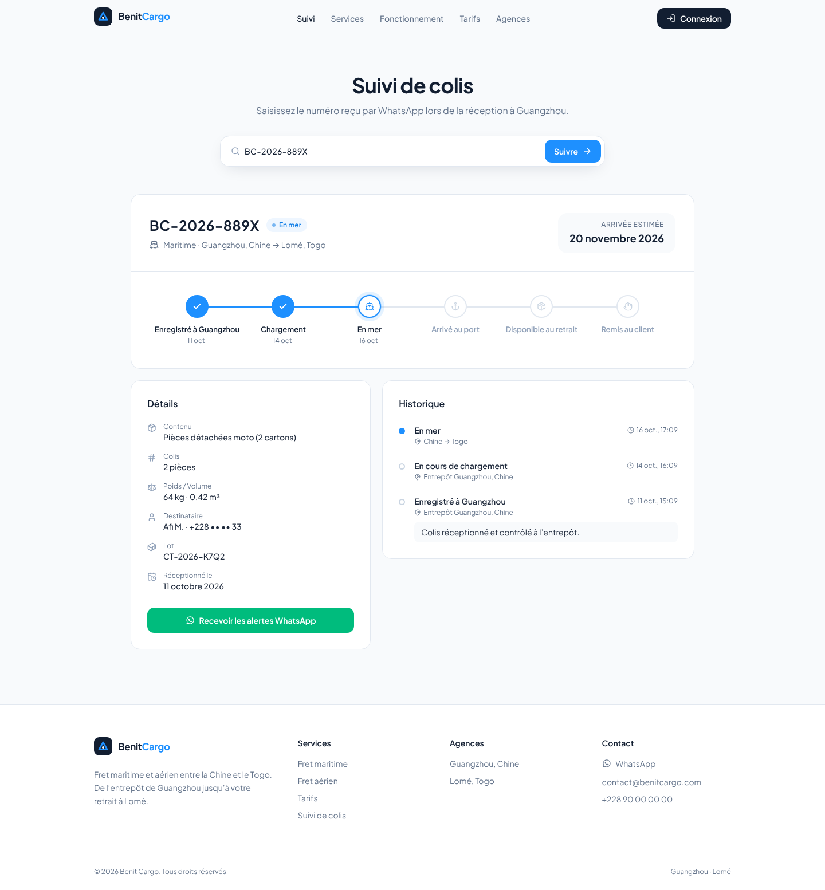
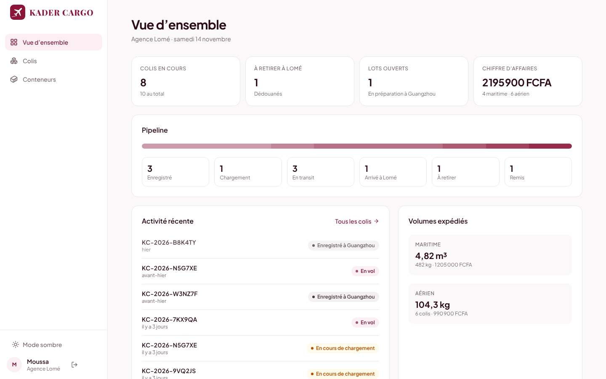

# Benit Cargo — Plateforme de fret & tracking Chine → Togo

MVP de l'application web décrite dans le cahier des charges v1.1 : site public avec suivi de colis, espace client sécurisé et back-office multi-agences (Guangzhou / Lomé).

| Accueil | Suivi de colis |
|---|---|
|  |  |
| **Espace client** | **Back-office** |
|  |  |

## Démarrage rapide

Prérequis : Node.js ≥ 22.

```bash
npm run setup   # installe api + web, crée api/.env (secret JWT aléatoire), base SQLite + données de démo
npm run dev     # API sur :4000, SPA sur http://localhost:5173 (proxy /api)
npm test        # 21 tests d'intégration de l'API (auth, RBAC, CSRF, rate-limit, workflow)
```

### Comptes de démonstration

| Rôle | Identifiant | Mot de passe |
|---|---|---|
| Administrateur | `admin@benitcargo.com` | `Admin#Benit2026` |
| Entrepôt Guangzhou | `gz@benitcargo.com` | `Guangzhou#2026` |
| Agence Lomé | `lome@benitcargo.com` | `Lome#Agence2026` |
| Client (Afi Mensah) | `90 11 22 33` | `Client#2026` |
| Client (Yao Kodjo) | `+228 91 44 55 66` | `Client#2026` |

Numéros de suivi publics de démo : `BC-2026-889X` (en mer), `BC-2026-7KX9QA` (en vol), `BC-2026-R2D4HN` (à retirer).

## Architecture

```
┌─────────────────────────┐   HTTPS · JSON · cookies HttpOnly   ┌──────────────────────────┐
│  web/  SPA React 19     │ ──────────────────────────────────▶ │  api/  Express 5 + TS    │
│  Vite · Tailwind v4     │      /api/v1/*  (+ X-CSRF-Token)     │  Prisma 7 · SQLite (dev) │
│  servie par CDN         │ ◀────────────────────────────────── │  stateless (JWT)         │
└─────────────────────────┘                                      └──────────────────────────┘
```

- **Découplage strict** : l'API ne rend aucun HTML (CSP `default-src 'none'`), la SPA ne contient aucune logique métier — prix, numéros de suivi, transitions de statut et droits sont décidés côté serveur.
- **Base de données** : SQLite pour le MVP ; passer `provider = "postgresql"` dans `api/prisma/schema.prisma` (+ adaptateur `@prisma/adapter-pg`) pour la production.

### Arborescence

```
api/
  prisma/schema.prisma      modèle : User, RefreshToken, Shipment, ShipmentEvent, Container, Photo, Notification
  prisma/seed.ts            données de démonstration
  src/app.ts                Helmet, CORS, CSRF, routes /api/v1
  src/lib/security.ts       Argon2id, JWT, hachage des refresh tokens
  src/lib/domain.ts         statuts, RBAC des transitions, tarifs, générateur BC-AAAA-XXXXXX
  src/lib/whatsapp.ts       alertes WhatsApp (Twilio ou mode simulé)
  src/lib/pdf.ts            factures A4 et étiquettes 100×150 mm (code-barres + QR)
  src/routes/*.ts           auth, tracking, shipments, containers, users
  test/api.test.ts          tests d'intégration (Vitest + Supertest)
web/
  src/pages/                Home, Track, Login, client/*, admin/*
  src/lib/api.ts            client HTTP : CSRF en mémoire + rotation silencieuse du refresh token
  public/_headers           en-têtes de sécurité CDN (CSP, HSTS, X-Frame-Options)
```

## Fonctionnalités

**Thème clair / sombre** — bouton soleil/lune dans chaque menu (site public, menu mobile, espace client, barre latérale du back-office, connexion). Suit le réglage du système tant que l'utilisateur n'a pas choisi ; le choix est mémorisé dans le navigateur et appliqué avant le premier affichage (`web/public/theme-init.js`, compatible avec la CSP). Les couleurs sont des variables CSS redéfinies sous `.dark` dans `web/src/index.css`.

**Public** — page d'accueil (services, fonctionnement, estimateur de prix, agences), recherche de colis, frise de progression *Enregistré à Guangzhou → Chargement → En mer / En vol → Arrivé à Lomé → Disponible au retrait → Remis*, historique détaillé, lien d'alerte WhatsApp. Les données personnelles sont masquées (`Afi M.`, `+228 •• •• 33`).

**Espace client** — tous les colis liés au téléphone ou à l'email du compte, détail avec photos de contrôle qualité (agrandissables) et facture PDF téléchargeable.

**Back-office (RBAC)**

| Action | Entrepôt GZ | Agence Lomé | Admin |
|---|:-:|:-:|:-:|
| Réception d'un colis (pesée, volume, photos) + étiquette | ✓ | | ✓ |
| Statuts Enregistré / Chargement / En transit | ✓ | | ✓ |
| Statuts Arrivé / Dédouané-à retirer / Remis | | ✓ | ✓ |
| Créer, remplir, clôturer un lot (conteneur ou vol) | ✓ | | ✓ |
| Mise à jour de statut en masse d'un lot | ✓ (ses étapes) | ✓ (ses étapes) | ✓ |
| Gestion des comptes | | | ✓ |

Les agents ne peuvent que faire avancer un colis ; l'admin peut corriger. Chaque changement de statut crée un événement daté et envoie une alerte WhatsApp au client.

## API

| Méthode | Endpoint | Accès |
|---|---|---|
| GET | `/api/v1/auth/csrf` | Public — émet le jeton CSRF |
| POST | `/api/v1/auth/login` | Public, **5 tentatives / IP / 15 min** |
| POST | `/api/v1/auth/refresh` | Cookie refresh — rotation + détection de réutilisation |
| POST | `/api/v1/auth/logout` | Authentifié — révoque la famille de tokens |
| GET | `/api/v1/auth/me` · `/auth/session` | Authentifié · sonde sans 401 |
| GET | `/api/v1/tracking/{tracking_id}` | Public, 30 req/min/IP |
| GET | `/api/v1/shipments` · `/shipments/stats` | Personnel |
| GET | `/api/v1/shipments/mine` | Client |
| POST | `/api/v1/shipments` (multipart, photos) | Admin / Agent Guangzhou |
| GET | `/api/v1/shipments/{id}` · `/invoice.pdf` · `/photos/{photoId}` | Personnel ou client propriétaire |
| GET | `/api/v1/shipments/{id}/label.pdf` | Personnel |
| PATCH | `/api/v1/shipments/{id}/status` | Admin / Agent Lomé / Agent GZ (selon l'étape) + WhatsApp |
| POST | `/api/v1/shipments/{id}/photos` | Admin / Agent Guangzhou |
| GET/POST/PATCH | `/api/v1/containers[/{id}]` | Personnel / GZ |
| POST/DELETE | `/api/v1/containers/{id}/shipments` | GZ — affectation des colis |
| POST | `/api/v1/containers/{id}/close` | GZ — clôture → « Chargement » |
| PATCH | `/api/v1/containers/{id}/status` | Mise à jour en masse |
| GET/POST/PATCH | `/api/v1/users` | Admin |

## Sécurité (§3 du cahier des charges)

- **Mots de passe** : Argon2id (64 Mio, 3 passes), sel aléatoire de 16 octets par utilisateur, jamais stockés ni journalisés en clair. Vérification à temps quasi constant (hash factice si l'utilisateur n'existe pas) et message d'erreur générique.
- **Sessions** : access JWT HS256 de 15 min + refresh token opaque de 7 jours, uniquement en cookies `HttpOnly; Secure; SameSite=Strict` préfixés `__Host-` en production. Refresh token stocké haché (SHA-256), rotation à chaque usage ; la réutilisation d'un token déjà tourné révoque toute la famille. Aucun JWT dans le `localStorage`.
- **CSRF** : double-soumission (cookie HttpOnly + en-tête `X-CSRF-Token`) en plus de `SameSite=Strict` ; fonctionne aussi si SPA et API sont sur des origines différentes.
- **Injection** : Prisma uniquement (requêtes préparées) ; DTO Zod `.strict()` sur chaque entrée — tout champ inconnu est rejeté.
- **Contrôle d'accès** : RBAC par rôle + contrôle au niveau objet (un client reçoit 404 sur le colis d'un autre).
- **Fichiers** : images vérifiées par signature binaire (JPEG/PNG/WebP), 5 Mo max, noms aléatoires, servies uniquement après contrôle d'accès.
- **En-têtes** : Helmet (CSP, HSTS preload, `X-Frame-Options: DENY`, `Referrer-Policy`), `web/public/_headers` pour la SPA.
- **Limitation** : login 5/15 min/IP, suivi public 30/min/IP (anti-énumération ; numéros à 6 caractères aléatoires).

## Mise en production

1. `api/.env` : `NODE_ENV=production`, `JWT_SECRET` (≥ 48 octets aléatoires), `DATABASE_URL`, `CORS_ORIGINS=https://benitcargo.com`, `TRUST_PROXY=1` derrière un reverse-proxy. En production les cookies sont forcés en `Secure` avec préfixe `__Host-`.
2. `npm --prefix api run db:deploy`, puis `npm --prefix api start` (TLS 1.3 terminé par le reverse-proxy).
3. SPA : `VITE_API_URL=https://api.benitcargo.com npm run build`, puis déployer `web/dist` sur le CDN (ajuster `connect-src` dans `_headers`). Servir SPA et API sur le même site (ex. `benitcargo.com` / `api.benitcargo.com`) pour que les cookies `SameSite=Strict` soient envoyés.
4. WhatsApp : renseigner `TWILIO_ACCOUNT_SID`, `TWILIO_AUTH_TOKEN`, `TWILIO_WHATSAPP_FROM`. Sans ces variables, les messages sont simulés (journalisés et visibles dans le back-office).

## À compléter avant lancement

- Coordonnées réelles des agences et numéro WhatsApp : `web/src/lib/site.ts` (valeurs fictives pour l'instant).
- Tarifs : `api/src/lib/domain.ts` (`TARIFFS`) — dupliqués côté SPA pour l'estimateur uniquement (`Home.tsx`, `NewShipment.tsx`).
- Hors périmètre MVP : inscription client en libre-service (nécessite une vérification OTP du téléphone), paiement Mobile Money, stockage objet (S3) pour les photos, envoi des templates WhatsApp Business approuvés.
