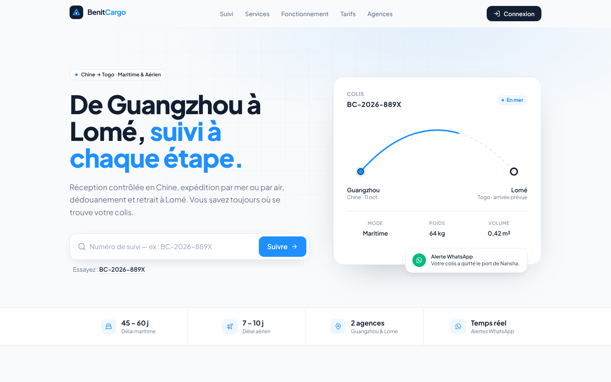
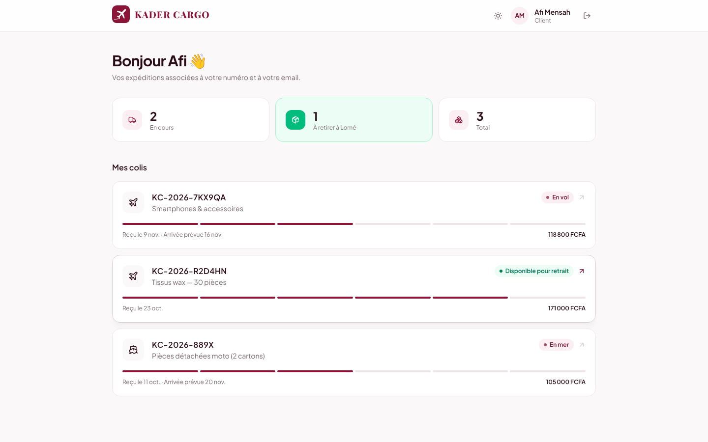

<p align="center"></p>

# Kader Cargo — Express Air Cargo Guangzhou → Lomé

Plateforme web de fret et de suivi de colis (cahier des charges v1.1) : site public avec suivi, espace client sécurisé et back-office multi-agences (Guangzhou / Lomé). Livraison porte-à-porte vers Lomé, Accra, Abidjan, Cotonou et Niamey.

Charte : **rouge bordeaux `#8B1538` et blanc**, logo avec avion (`brand/`).

| Accueil | Suivi de colis |
|---|---|
|  |  |
| **Espace client** | **Back-office** |
|  |  |

## Démarrage rapide

Prérequis : Node.js ≥ 22.

```bash
npm run setup   # installe api + web, crée api/.env (secret JWT aléatoire), base SQLite + données de démo
npm run dev     # installe les dépendances manquantes, applique les migrations, puis API :4000 + SPA http://localhost:5173
npm test        # 42 tests d'intégration de l'API (auth, inscription/OTP, Google, RBAC, CSRF, workflow, alertes)
```

Après un `git pull`, relancez simplement `npm run dev` : les nouvelles dépendances et migrations sont installées automatiquement (`npm run sync`).

### Comptes de démonstration

| Rôle | Identifiant | Mot de passe |
|---|---|---|
| Administrateur (Kader) | `admin@kadercargo.com` | `Admin#Kader2026` |
| Entrepôt Guangzhou (Mounkaila) | `gz@kadercargo.com` | `Guangzhou#2026` |
| Agence Lomé (Moussa) | `lome@kadercargo.com` | `Lome#Agence2026` |
| Client (Afi Mensah) | `90 11 22 33` | `Client#2026` |
| Client (Yao Kodjo) | `+228 91 44 55 66` | `Client#2026` |

Un client inscrit via le site attend déjà une validation : **Kossi Amegah** (`+228 92 33 44 55`), visible dans *Utilisateurs → À valider* et dans la cloche de notifications de l’administrateur.

En démo (sans WhatsApp ni SMTP configurés), les codes de vérification s’affichent sur la page dans un encadré « Mode démo » et dans la console de l’API. Cet encadré n’existe jamais en production.

Numéros de suivi publics de démo : `KC-2026-7KX9QA` (en vol), `KC-2026-R2D4HN` (à retirer), `KC-2026-889X` (maritime, en mer).

## Architecture

```
┌─────────────────────────┐   HTTPS · JSON · cookies HttpOnly   ┌──────────────────────────┐
│  web/  SPA React 19     │ ──────────────────────────────────▶ │  api/  Express 5 + TS    │
│  Vite · Tailwind v4     │      /api/v1/*  (+ X-CSRF-Token)     │  Prisma 7 · SQLite (dev) │
│  servie par CDN         │ ◀────────────────────────────────── │  stateless (JWT)         │
└─────────────────────────┘                                      └──────────────────────────┘
```

- **Découplage strict** : l'API ne rend aucun HTML (CSP `default-src 'none'`), la SPA ne contient aucune logique métier — prix, numéros de suivi, transitions de statut et droits sont décidés côté serveur.
- **Base de données** : SQLite pour le MVP ; passer `provider = "postgresql"` dans `api/prisma/schema.prisma` (+ adaptateur `@prisma/adapter-pg`) pour la production.

### Arborescence

```
api/
  prisma/schema.prisma      modèle : User, RefreshToken, Shipment, ShipmentEvent, Container, Photo, Notification
  prisma/seed.ts            données de démonstration
  src/app.ts                Helmet, CORS, CSRF, routes /api/v1
  src/lib/security.ts       Argon2id, JWT, hachage des refresh tokens
  src/lib/domain.ts         statuts, RBAC des transitions, tarifs, générateur KC-AAAA-XXXXXX
  src/lib/whatsapp.ts       alertes WhatsApp à chaque étape (Twilio, Meta Cloud API ou simulé)
  src/lib/company.ts        coordonnées Kader Cargo (agences, contacts)
  src/lib/pdf.ts            factures A4 et étiquettes 100×150 mm (code-barres + QR)
  src/routes/*.ts           auth, tracking, shipments, containers, users
  test/api.test.ts          tests d'intégration (Vitest + Supertest)
brand/                      logo (SVG vectoriel + PNG), script de génération build-logo.mjs
web/
  src/lib/site.ts           coordonnées affichées sur le site
  src/pages/                Home, Track, Login, client/*, admin/*
  src/lib/api.ts            client HTTP : CSRF en mémoire + rotation silencieuse du refresh token
  public/_headers           en-têtes de sécurité CDN (CSP, HSTS, X-Frame-Options)
```

## Fonctionnalités

**Thème clair / sombre** — bouton soleil/lune dans chaque menu (site public, menu mobile, espace client, barre latérale du back-office, connexion). Suit le réglage du système tant que l'utilisateur n'a pas choisi ; le choix est mémorisé dans le navigateur et appliqué avant le premier affichage (`web/public/theme-init.js`, compatible avec la CSP). Les couleurs sont des variables CSS redéfinies sous `.dark` dans `web/src/index.css`.

**Public** — page d'accueil (services, fonctionnement, estimateur de prix, agences), recherche de colis, frise de progression *Enregistré à Guangzhou → Chargement → En mer / En vol → Arrivé à Lomé → Disponible au retrait → Remis*, historique détaillé, lien d'alerte WhatsApp. Les données personnelles sont masquées (`Afi M.`, `+228 •• •• 33`).

**Espace client** — tous les colis liés au téléphone ou à l'email du compte, détail avec photos de contrôle qualité (agrandissables) et facture PDF téléchargeable.

**Back-office (RBAC)**

| Action | Entrepôt GZ | Agence Lomé | Admin |
|---|:-:|:-:|:-:|
| Réception d'un colis (pesée, volume, photos) + étiquette | ✓ | | ✓ |
| Statuts Enregistré / Chargement / En transit | ✓ | | ✓ |
| Statuts Arrivé / Dédouané-à retirer / Remis | | ✓ | ✓ |
| Créer, remplir, clôturer un lot (conteneur ou vol) | ✓ | | ✓ |
| Mise à jour de statut en masse d'un lot | ✓ (ses étapes) | ✓ (ses étapes) | ✓ |
| Gestion des comptes | | | ✓ |

Les agents ne peuvent que faire avancer un colis ; l'admin peut corriger. Chaque étape franchie crée un événement daté et envoie au client un message WhatsApp rédigé pour cette étape — voir [docs/whatsapp-alertes.md](docs/whatsapp-alertes.md) (messages, règles, modèles à faire approuver, configuration Twilio / Meta).

## Comptes clients et connexion

- **Inscription** (`/inscription`) avec un numéro WhatsApp **ou** une adresse e-mail (Gmail ou autre) : un code à 6 chiffres est envoyé par WhatsApp ou par e-mail pour prouver que le numéro/l’adresse appartient au client. Mot de passe facultatif.
- **Validation par l’administrateur** : le compte reste *en attente* tant qu’un admin ne l’a pas validé (*Utilisateurs → À valider*). Le client est prévenu par WhatsApp ou e-mail à la validation (ou au refus, avec un motif facultatif).
- **Toutes les méthodes de connexion**, liées au même compte : code WhatsApp, code e-mail, mot de passe, « Continuer avec Google ». Depuis *Mon compte*, le client ajoute un téléphone, un e-mail, Google ou un mot de passe ; chaque ajout est vérifié par un code (ou par Google).
- Un compte Google dont l’adresse Gmail vérifiée correspond à un compte existant y est lié automatiquement.
- Les identifiants (téléphone, e-mail) ne sont enregistrés qu’une fois prouvés, car ils donnent accès aux colis enregistrés à ce numéro.

Sécurité des codes : 6 chiffres, seul un HMAC est stocké, validité 10 min, 5 essais, 1 envoi par minute et 5 par heure et par destinataire, limite par IP. L’inscription répond de la même façon qu’un compte existe ou non (pas d’énumération des clients).

Configuration : e-mail via SMTP (`SMTP_HOST`… — Gmail : `smtp.gmail.com` + mot de passe d’application), Google via `GOOGLE_CLIENT_ID` (OAuth, Google Cloud Console), WhatsApp : voir [docs/whatsapp-alertes.md](docs/whatsapp-alertes.md) (modèle `kader_otp` de catégorie *Authentification* chez Meta).

## Notifications du back-office

Une cloche (avec compteur) dans le back-office ; à chaque nouvel événement, un **son** est joué, une notification s’affiche à l’écran et — si l’agent l’autorise — une notification du navigateur apparaît quand l’onglet est en arrière-plan. Le son peut être coupé dans le panneau.

| Événement | Qui est notifié |
|---|---|
| Nouveau compte client à valider | Administrateurs |
| Conteneur / vol parti de Guangzhou | Administrateurs, agence Lomé |
| **Bateau / vol arrivé à Lomé** (mise à jour du lot) | Administrateurs, agences Lomé et Guangzhou |
| Colis arrivé à Lomé (hors lot) | Administrateurs, entrepôt Guangzhou |
| Alerte WhatsApp non délivrée après 3 essais | Administrateurs |

Le navigateur interroge l’API toutes les 10 s (`GET /api/v1/staff/notifications?after=…`), ce qui reste compatible avec une API sans état et plusieurs serveurs.

## API

| Méthode | Endpoint | Accès |
|---|---|---|
| GET | `/api/v1/auth/csrf` | Public — émet le jeton CSRF |
| POST | `/api/v1/auth/login` | Public, **5 tentatives / IP / 15 min** |
| POST | `/api/v1/auth/refresh` | Cookie refresh — rotation + détection de réutilisation |
| POST | `/api/v1/auth/logout` | Authentifié — révoque la famille de tokens |
| GET | `/api/v1/auth/me` · `/auth/session` | Authentifié · sonde sans 401 |
| POST | `/api/v1/auth/register/start` · `/register/verify` | Public — inscription par code WhatsApp / e-mail |
| POST | `/api/v1/auth/otp/request` · `/otp/verify` | Public — connexion par code |
| POST | `/api/v1/auth/google` | Public — « Continuer avec Google » |
| GET/POST/DELETE | `/api/v1/account` · `/account/link/*` · `/account/password` | Authentifié — moyens de connexion liés |
| POST | `/api/v1/users/{id}/approval` | Admin — valider / refuser un compte |
| GET/POST | `/api/v1/staff/notifications` · `/read` | Personnel — cloche de notifications |
| GET | `/api/v1/tracking/{tracking_id}` | Public, 30 req/min/IP |
| GET | `/api/v1/shipments` · `/shipments/stats` | Personnel |
| GET | `/api/v1/shipments/mine` | Client |
| POST | `/api/v1/shipments` (multipart, photos) | Admin / Agent Guangzhou |
| GET | `/api/v1/shipments/{id}` · `/invoice.pdf` · `/photos/{photoId}` | Personnel ou client propriétaire |
| GET | `/api/v1/shipments/{id}/label.pdf` | Personnel |
| PATCH | `/api/v1/shipments/{id}/status` | Admin / Agent Lomé / Agent GZ (selon l'étape) + WhatsApp |
| POST | `/api/v1/shipments/{id}/photos` | Admin / Agent Guangzhou |
| GET | `/api/v1/shipments/{id}/alert-preview?status=` | Personnel — aperçu du message WhatsApp |
| POST | `/api/v1/shipments/{id}/notifications/{nid}/resend` | Personnel — renvoi d'une alerte |
| GET/POST/PATCH | `/api/v1/containers[/{id}]` | Personnel / GZ |
| POST/DELETE | `/api/v1/containers/{id}/shipments` | GZ — affectation des colis |
| POST | `/api/v1/containers/{id}/close` | GZ — clôture → « Chargement » |
| PATCH | `/api/v1/containers/{id}/status` | Mise à jour en masse |
| GET/POST/PATCH | `/api/v1/users` | Admin |

## Sécurité (§3 du cahier des charges)

- **Mots de passe** : Argon2id (64 Mio, 3 passes), sel aléatoire de 16 octets par utilisateur, jamais stockés ni journalisés en clair. Vérification à temps quasi constant (hash factice si l'utilisateur n'existe pas) et message d'erreur générique.
- **Sessions** : access JWT HS256 de 15 min + refresh token opaque de 7 jours, uniquement en cookies `HttpOnly; Secure; SameSite=Strict` préfixés `__Host-` en production. Refresh token stocké haché (SHA-256), rotation à chaque usage ; la réutilisation d'un token déjà tourné révoque toute la famille. Aucun JWT dans le `localStorage`.
- **CSRF** : double-soumission (cookie HttpOnly + en-tête `X-CSRF-Token`) en plus de `SameSite=Strict` ; fonctionne aussi si SPA et API sont sur des origines différentes.
- **Injection** : Prisma uniquement (requêtes préparées) ; DTO Zod `.strict()` sur chaque entrée — tout champ inconnu est rejeté.
- **Contrôle d'accès** : RBAC par rôle + contrôle au niveau objet (un client reçoit 404 sur le colis d'un autre).
- **Fichiers** : images vérifiées par signature binaire (JPEG/PNG/WebP), 5 Mo max, noms aléatoires, servies uniquement après contrôle d'accès.
- **En-têtes** : Helmet (CSP, HSTS preload, `X-Frame-Options: DENY`, `Referrer-Policy`), `web/public/_headers` pour la SPA.
- **Limitation** : login 5/15 min/IP, suivi public 30/min/IP (anti-énumération ; numéros à 6 caractères aléatoires).

## Mise en production

1. `api/.env` : `NODE_ENV=production`, `JWT_SECRET` (≥ 48 octets aléatoires), `DATABASE_URL`, `CORS_ORIGINS=https://kadercargo.com`, `TRUST_PROXY=1` derrière un reverse-proxy. En production les cookies sont forcés en `Secure` avec préfixe `__Host-`.
2. `npm --prefix api run db:deploy`, puis `npm --prefix api start` (TLS 1.3 terminé par le reverse-proxy).
3. SPA : `VITE_API_URL=https://api.kadercargo.com npm run build`, puis déployer `web/dist` sur le CDN (ajuster `connect-src` dans `_headers`). Servir SPA et API sur le même site (ex. `kadercargo.com` / `api.kadercargo.com`) pour que les cookies `SameSite=Strict` soient envoyés.
4. WhatsApp : Twilio ou Meta Cloud API, voir [docs/whatsapp-alertes.md](docs/whatsapp-alertes.md). Renseigner aussi `PUBLIC_WEB_URL` pour inclure le lien de suivi dans les messages. Sans identifiants, les messages sont simulés (journalisés et visibles dans le back-office).

## À compléter avant lancement

- Coordonnées : reprises de la carte de visite Kader Cargo dans `web/src/lib/site.ts` (site) et `api/src/lib/company.ts` (messages, PDF). L'adresse précise de l'agence de Lomé n'y figure pas encore.
- Tarifs : `api/src/lib/domain.ts` (`TARIFFS`) — dupliqués côté SPA pour l'estimateur uniquement (`Home.tsx`, `NewShipment.tsx`).
- Hors périmètre MVP : paiement Mobile Money, stockage objet (S3) pour les photos.
